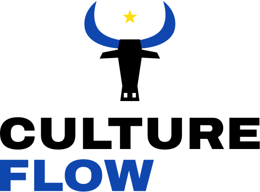
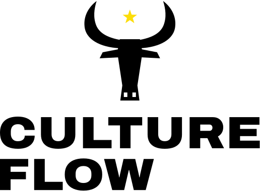
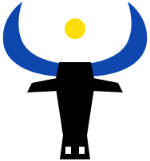
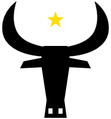
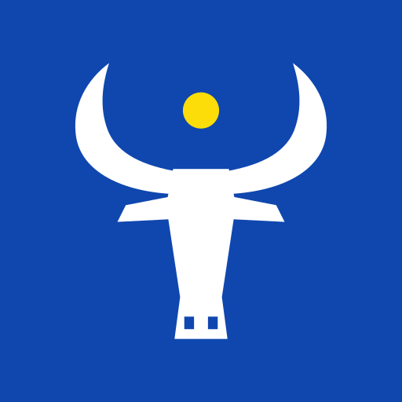
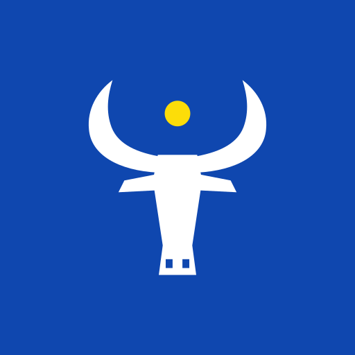
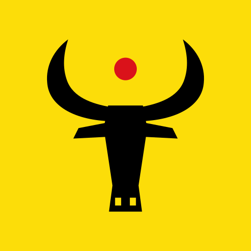
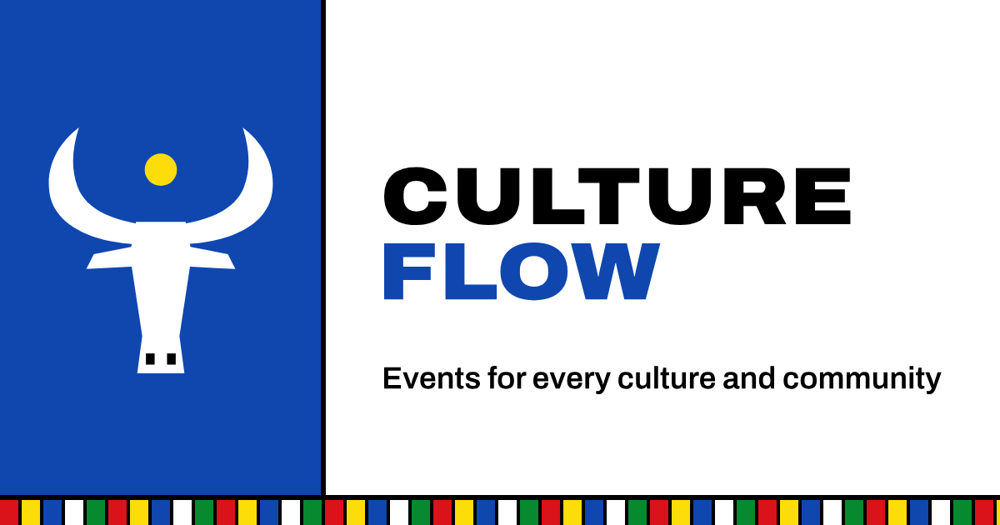

# CultureFlow brand

<p align="center"></p>

## The mark

A long-horned cow, drawn from flat, sharp-edged shapes. Across Africa, Asia, Europe and the Americas, cattle have stood for gathering, celebration and shared wealth. The brand began in South Sudanese cattle culture and now opens that idea to every community.

- **Open lyre horns** in blue.
- **A gold sun** cradled between the horn tips: a gathering under one sky.
- **A long black face** with angled ears and a flared muzzle.

The name is set as a two-line block, **CULTURE / FLOW**, in wide Archivo Black capitals. FLOW takes the horn colour so the words read as part of the mark.

The identity uses flat colour only: no gradients, no blur, no rounded corners. The same rules apply in the app UI. It deliberately uses no national flags or symbols, so no single culture owns it.

## Colours

| | Name | Hex | Used for |
|---|---|---|---|
| ⬛ | Black | `#000000` | Head, CULTURE, headlines |
| 🟦 | Blue | `#0F47AF` | Horns, FLOW, app icon tile |
| 🟨 | Gold | `#FCDD09` | The sun; FLOW on dark backgrounds |
| 🟥 | Red | `#DA121A` | Accent |
| 🟩 | Green | `#078930` | Accent |
| ⬜ | White | `#FFFFFF` | Reversed logo, nostrils |

## Variants

All files live in [`public/`](../public). Never edit them by hand. They are generated:

```bash
npm run brand:build   # every SVG below (also runs on predev/prebuild)
npm run brand:png     # favicon.ico, apple-touch-icon, PWA icons, og-image.png
```

### Lockups

| File | Preview | Use |
|---|---|---|
| `logo-horizontal.svg` |  | Site header, navigation, emails |
| `logo-horizontal-black.svg` |  | One-colour printing, stamps, faxes |
| `logo-horizontal-white.svg` |  | Dark backgrounds (site footer) |
| `logo-stacked.svg` / `logo.svg` |  | Hero, about page, posters, the master file |
| `logo-stacked-black.svg` |  | One colour |
| `logo-stacked-white.svg` |  | Dark or blue backgrounds |

### Mark

| File | Preview | Use |
|---|---|---|
| `logo-mark.svg` |  | Avatars, placeholders, compact headers |
| `logo-mark-black.svg` |  | One colour |
| `logo-mark-white.svg` |  | Dark backgrounds |
| `logo-mark-mono.svg` |  | Inline SVG only: fills with `currentColor` |

### Name

| File | Preview | Use |
|---|---|---|
| `logo-wordmark.svg` |  | When the mark is already nearby |
| `logo-wordmark-black.svg` |  | One colour |
| `logo-wordmark-white.svg` |  | Dark backgrounds |
| `logo-wordmark-line.svg` |  | Very wide, very short spaces (banners, tickets) |

### Icons

| File | Preview | Use |
|---|---|---|
| `logo-app-icon.svg` |  | Browser tab icon, PWA |
| `logo-app-icon-maskable.svg` |  | Android adaptive icons (mark inside the safe zone) |
| `logo-app-icon-yellow.svg` |  | Alternate tile: merch, social avatars |
| `favicon.ico` | | Legacy browsers (16, 32, 48 px) |
| `apple-touch-icon.png` | | iOS home screen (180 px) |
| `icons/icon-192.png`, `icons/icon-512.png`, `icons/icon-maskable-512.png` | | Web app manifest (`src/app/manifest.ts`) |
| `og-image.png` |  | Link previews (WhatsApp, X, Facebook, iMessage) |

## Rules

- **Clear space:** keep at least the height of the sun empty around the logo.
- **Minimum size:** horizontal lockup 32 px tall; mark 16 px (use the app icon below 24 px).
- **Backgrounds:** full colour on white or gold. On black or blue, use the `-white` versions.
- **Don't:** recolour the horns outside the palette, add gradients, shadows or outlines, round the corners, add flags or national symbols, or set the name in another typeface.

## In code

```tsx
import Logo from "@/components/Logo";

<Logo />                                  // horizontal, full colour
<Logo variant="stacked" size={200} />
<Logo variant="mark" size={40} />
<Logo tone="white" />                     // reversed, for dark surfaces
<Logo tone="black" />                     // one colour
```

Paths and aspect ratios are exported from [`src/lib/brand.ts`](../src/lib/brand.ts) as `BRAND_LOGOS` and `BRAND_ASPECTS`.

## Sources

- Mark geometry: [`scripts/build-brand-svgs.mjs`](../scripts/build-brand-svgs.mjs).
- Lettering outlines: [`scripts/brand/glyphs.json`](../scripts/brand/glyphs.json), generated from [Archivo](https://github.com/Omnibus-Type/Archivo) (SIL Open Font License) by [`scripts/brand/make-glyphs.mjs`](../scripts/brand/make-glyphs.mjs). Re-run it only if the name or tagline changes.
